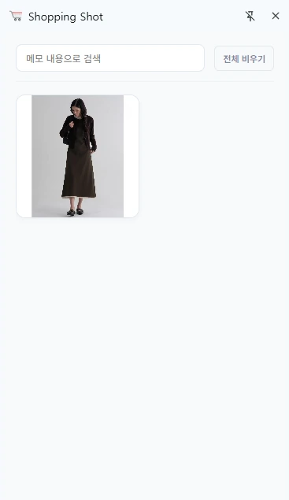
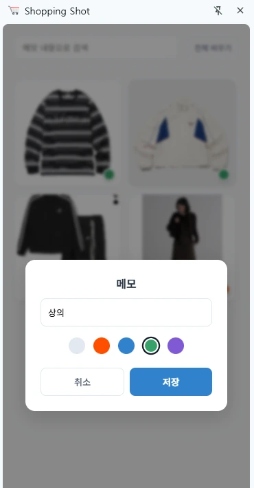
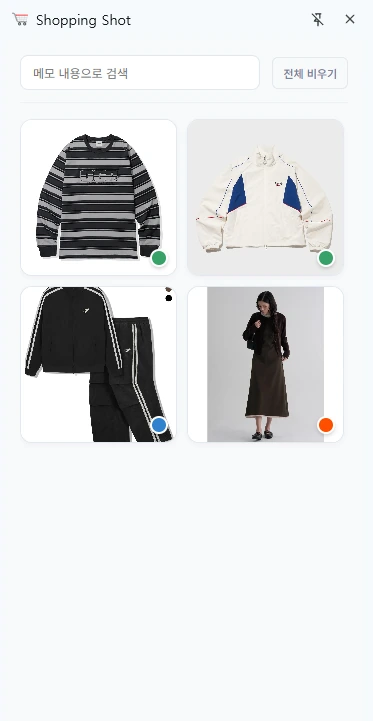
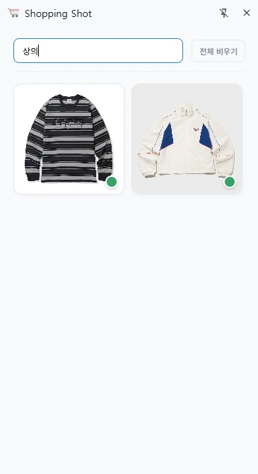
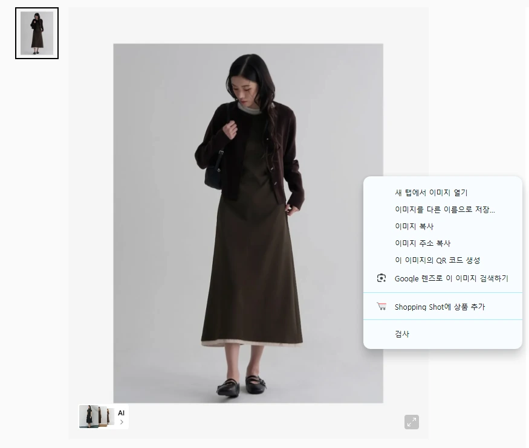

# Shopping Shot — 우클릭 한 번으로 모으는 쇼핑 장바구니

> 쇼핑몰을 돌아다니다 마음에 드는 상품 이미지를 **우클릭 한 번**으로 담아 두는 Chrome 확장 프로그램입니다.
> 담은 상품은 보던 화면 옆 사이드 패널에 모이고, 나만의 메모와 색으로 표시해 두었다가 다시 찾아볼 수 있어요.

**🔗 사용 화면 미리보기** 

<p>
  
  
  
  
</p>

<br>

## 📌 프로젝트 개요

| 항목 | 내용 |
| --- | --- |
| 기간 | 5/18 – 5/21 |
| 형태 | Chrome 확장 프로그램 (Manifest V3) |
| 환경 | Chrome 데스크톱 브라우저 |

<br>

## 🤔 해결하고 싶었던 문제

사고 싶은 물건이 생기면 **여러 쇼핑몰의 탭을 오가며** 비교하게 됩니다.
나중에 다시 찾으려면 처음부터 검색해야 하고, 어디에서 봤는지 기억나지 않아 헤매기도 해요.

Shopping Shot은 보던 쇼핑몰 화면을 벗어나지 않고, 마음에 드는 상품을 **그 자리에서 바로 담아 두는** 나만의 장바구니입니다.

<br>

## ✨ 주요 기능

- **원클릭 스크랩**: 상품 이미지 위에서 우클릭하고 `Shopping Shot에 상품 추가`를 누르면 바로 담깁니다. Windows에서는 우클릭 후 `S` 키로도 담을 수 있어요.
- **진짜 상품 페이지 주소 저장**: 이미지가 속한 상품 카드의 링크를 찾아서, 현재 목록 페이지가 아닌 **그 상품의 상세 페이지 주소**를 함께 저장합니다. 담아 둔 상품을 누르면 상세 페이지가 새 탭으로 열려요.
- **사이드 패널 장바구니**: Chrome 내장 `sidePanel`을 사용해 쇼핑하는 화면 옆에 장바구니를 띄워 두고 바로 확인합니다. 상품을 담으면 패널이 자동으로 열려요.
- **메모와 색 표시**: 상품에 메모(사이즈, 고민되는 점 등)를 남기고 네 가지 색으로 나눠 표시할 수 있습니다.
- **메모 검색**: 입력하는 즉시 메모 내용에 맞는 상품만 걸러서 보여 줍니다.
- **끌어서 순서 바꾸기**: 상품 카드를 드래그해 우선순위대로 정렬할 수 있습니다. 새로 담은 상품은 맨 앞에 쌓여요.
- **실수 방지**: 이미 담은 상품은 중복 저장하지 않고 안내하며, 전체 비우기는 한 번 더 확인합니다.
- **이미지 유실 대비**: 쇼핑몰이 이미지를 막거나 링크가 만료되어도 깨진 그림 대신 기본 아이콘으로 표시됩니다.

<p>
  
</p>

<br>

## 📖 사용 방법

1. 쇼핑몰에서 마음에 드는 상품 이미지 위를 **우클릭**합니다.
2. 메뉴의 **Shopping Shot에 상품 추가**를 누르면 사이드 패널에 담깁니다.
3. 상품에 마우스를 올리면 나타나는 **✎ 버튼**으로 메모와 색을 정합니다.
4. 패널 위쪽 검색창에 메모를 입력해 원하는 상품만 모아 봅니다.
5. 상품을 누르면 담았던 **상세 페이지**가 새 탭으로 열립니다.

<br>

## 🛠 기술 스택

| 구분 | 사용 기술 |
| --- | --- |
| Platform | Chrome Extensions API (Manifest V3) |
| Frontend | HTML, CSS (Grid · Flexbox · Animation), Vanilla JavaScript |
| Storage | `chrome.storage.local` |
| 사용 기능 | `contextMenus`, `sidePanel`, `storage`, `scripting`, `activeTab` |

<br>

## 📁 폴더 구조

```
manifest.json    권한 설정, 서비스 워커 · 콘텐츠 스크립트 등록
background.js    우클릭 메뉴 생성, 상품 저장, 사이드 패널 열기 (Service Worker)
content.js       우클릭한 이미지의 상품 상세 페이지 주소 추적
popup.html       사이드 패널 화면 구조 (메모 · 전체 삭제 모달 포함)
popup.css        카드 · 호버 · 드래그 효과 스타일
popup.js         목록 표시, 검색, 메모 · 색 수정, 정렬, 삭제, 알림
icon.png         확장 프로그램 아이콘 · 이미지 로드 실패 시 대체 이미지
guide.md         초기 기획서
docs/            README 화면 이미지
```

<br>

## 🔄 처음과 달라진 점

처음에는 상품명과 가격을 입력해 **가격을 비교**하는 도구로 기획했습니다. 
하지만 만들어 보니 입력할 것이 많아 번잡하게 느껴졌어요. 그래서 가격과 상품명 입력을 없애고 **상품 이미지 중심**으로 단순하게 바꿨습니다.

그 대신 상품마다 **메모와 색 표시**를 남길 수 있게 해서, 가격이 아니라 "상의 · 하의 · 고민 중"처럼 **나만의 기준**으로 저장하고 메모 검색으로 따로 모아 볼 수 있게 했습니다. 우클릭 메뉴에서 찾아 누르는 것도 번거로워서 `S` 키 단축키(Windows)를 추가했습니다.
